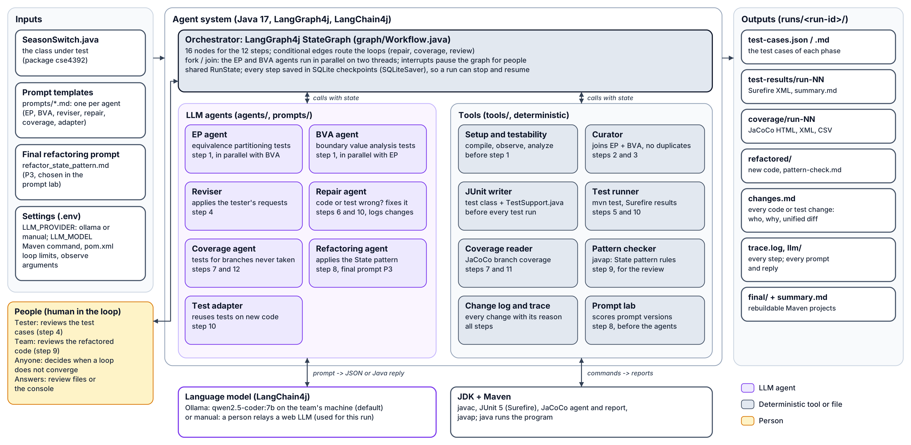
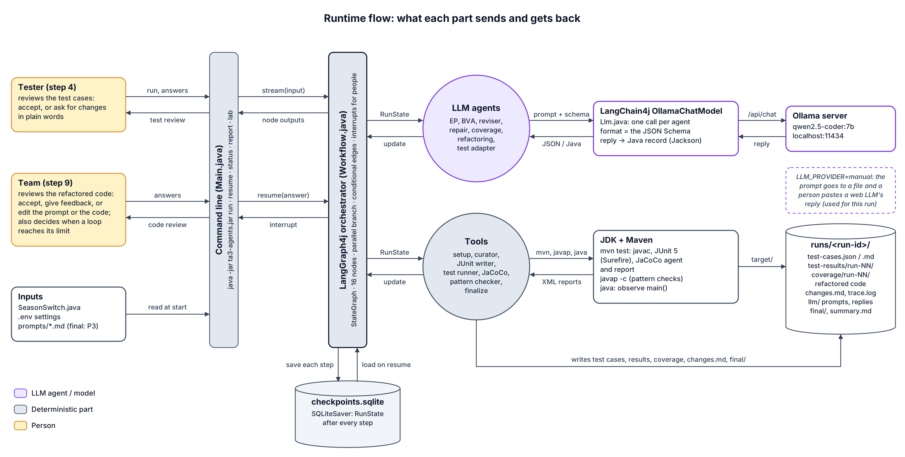
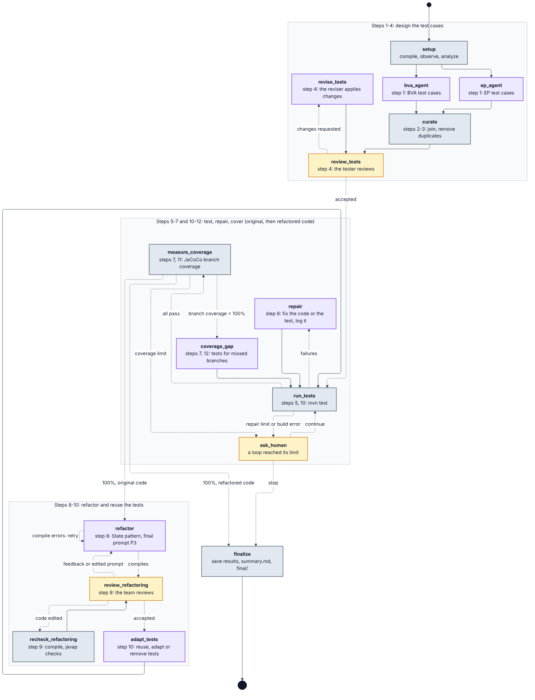
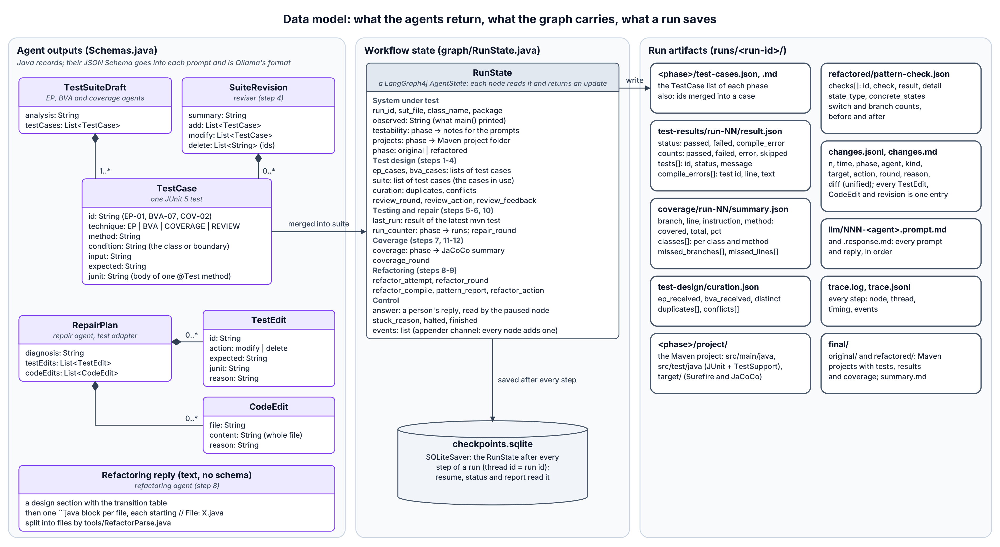

# TA3: a multi-agent system that tests and refactors SeasonSwitch

CSE 4392/5320 Software Engineering with Generative AI, Team Assignment 3 (Team 4).

A LangGraph4j workflow of LLM agents and deterministic tools that:

1. designs **equivalence partitioning** and **boundary value analysis** test cases with two agents running in parallel (steps 1-2),
2. joins them and removes duplicates (step 3),
3. asks the **tester** to review them (step 4, human in the loop),
4. runs them with Maven and JUnit 5, repairing the code or the tests until all pass, and logs every change (steps 5-6),
5. measures **branch coverage** with JaCoCo and adds tests until it is 100% (step 7),
6. refactors SeasonSwitch with the **State pattern** using the team's final prompt (step 8),
7. asks the **team** to review the refactored code (step 9, human in the loop),
8. reuses and adapts the tests on the refactored code, repairs, and reaches 100% branch coverage again (steps 10-12).

Everything is Java: the agent system (Java 17, **LangGraph4j** for the workflow, **LangChain4j** for the model),
the JUnit 5 tests it writes, and the refactored code. The language model runs locally with **Ollama**.

## Deliverables (what to submit)

`R` = `runs/seasonswitch-2026-11-02/final` (the recorded run).

| Deliverable | Where |
|---|---|
| Presentation | `deck/TA3-Multi-Agent-Testing-Team4.pptx` |
| Agent system code | `pom.xml`, `src/main/java/edu/uta/cse4392/ta3/`, `prompts/`, with its tests in `src/test/java/`, `.env.example` and this README |
| Test cases | `R/original/test-cases.md` and `R/refactored/test-cases.md` (also `.json`; the JUnit class is in `src/test/java`) |
| Test results | `R/original/test-results/` and `R/refactored/test-results/` (`summary.md`, Surefire XML) |
| Coverage | `R/original/coverage/` and `R/refactored/coverage/` (`summary.md`; open `jacoco/index.html`) |
| Architecture diagrams | `docs/diagrams/`: `architecture.png` (components), `architecture-flow.png` (runtime flow), `langgraph.png` (the compiled graph), `datamodel.png` (data model); see [Architecture](#architecture) |
| UML activity diagram | `docs/diagrams/activity.png` (and the two halves `activity-part1.png`, `activity-part2.png`) |
| Prompt that generated the system | `docs/agent-system-generation-prompt.md` |
| Refactoring prompt (step 8) | final: `prompts/refactor_state_pattern.md`; versions and scores: `docs/refactoring-prompt.md`, `prompt-lab/` |
| Every change to code or tests | `R/changes.md` |

## Requirements

| Tool | Version | Check |
|---|---|---|
| JDK | 17 or later | `java -version` and `javac -version` |
| Maven | 3.9 or later | `mvn -v` |
| Ollama | 0.5 or later | `ollama --version` |

```bash
ollama pull qwen2.5-coder:7b      # 4.7 GB; any model with good Java works (set LLM_MODEL)
```

## Build

```bash
mvn package                       # builds target/ta3-agents.jar and runs the agent system's tests
mvn package -DskipTests           # faster: build only
copy .env.example .env            # macOS/Linux: cp .env.example .env
```

Run the commands below from this folder (the one with `pom.xml`). The first build downloads LangGraph4j,
LangChain4j and the Maven plugins, and the first test run downloads JUnit and JaCoCo for the projects the
agents create, so it needs internet once. The end-to-end test runs the whole graph with a scripted model on a
small example class through real Maven, JUnit and JaCoCo; it takes a few minutes.

## Observe the program (What To Do, item 2)

```bash
cd season-switch
mvn compile exec:java                          # no argument = cool; stop with Ctrl+C
mvn compile exec:java -Dexec.args="heat"       # also: cool, off, or any other word
```

The agent system observes the program the same way in its setup step (each run stops after 4 s).

## Run the agent system

```bash
java -jar target/ta3-agents.jar run season-switch/src/main/java/cse4392/SeasonSwitch.java \
    --observe "" --observe cool --observe heat --observe off --observe warm
```

(On Windows `cmd`, write the command on one line, or end each line with `^` instead of `\`.)

The run prints each step. It **pauses** at every human-in-the-loop point:

- **Step 4, test review:** read `runs/<run-id>/original/review/round-N.md`, then answer `a` (accept),
  `r` (request changes in plain words), or `e` (you edited `original/test-cases.json` yourself).
- **Step 9, refactoring review:** read `runs/<run-id>/refactored/review/round-N.md`, which has the
  code and the automated State pattern checks. Answer `a` (accept), `f` (feedback, regenerate), `p`
  (you edited the prompt file, regenerate), or `c` (you edited the code, re-check).
- **A loop does not converge** (repair or coverage limit reached): `c` continue or `s` stop.

You can stop at a pause and continue later, even from another terminal:

```bash
java -jar target/ta3-agents.jar status <run-id>    # where the run is and what it waits for
java -jar target/ta3-agents.jar resume <run-id>    # continue (answers can also go in round-N.md.answer.txt)
java -jar target/ta3-agents.jar report <run-id>    # rewrite summary.md and final/
java -jar target/ta3-agents.jar list               # all runs
```

`--no-wait` never prompts; it uses answer files if present and otherwise pauses and exits.
`--auto-approve` accepts both reviews (unattended demo only). `--answer "revise: ..."` answers the next review.

### Using a web LLM instead of Ollama

Set `LLM_PROVIDER=manual` (and optionally `MANUAL_MODEL=<name>` so the run records which LLM you used).
Each agent's prompt is written to `runs/<run-id>/llm/NNN-<agent>.prompt.md`. Paste it into the web
LLM, save the whole answer as the matching `NNN-<agent>.response.md`, then `resume`. When the EP and BVA
agents wait at the same time, both prompts are listed. The recorded run in `runs/seasonswitch-2026-11-02`
was made this way, with Claude Opus 5.5 answering. Run it again with Ollama to get your own results.

## The refactoring prompt (step 8)

The versions are in `prompts/refactor_versions/` (P0 to P3). The final prompt is
`prompts/refactor_state_pattern.md` (= P3). Score the versions on a run's tested code:

```bash
java -jar target/ta3-agents.jar lab <run-id>                    # writes prompt-lab/<run-id>/<version>/prompt.md
java -jar target/ta3-agents.jar lab <run-id> --lab-id my-llm    # a new lab folder, so new replies are collected
```

With `LLM_PROVIDER=manual`, paste each `prompt.md` into the web LLM, save the answer as `reply.md`
next to it, and run the lab again. It reports, for each version: compiles, State pattern checks,
tests that compile unchanged, tests that pass, and branch coverage. A version that already has a
`reply.md` is only rescored, so use a new `--lab-id` to try another LLM. See `docs/refactoring-prompt.md`.

## What a run produces (`runs/<run-id>/`)

| Path | Contents |
|---|---|
| `original/observe.md`, `testability.md` | what the program printed; what makes it hard to test |
| `original/test-design/` | the EP and BVA agents' test cases and analysis, `curation.md` (duplicates) |
| `original/review/` | the test reviews and the answers |
| `original/test-cases.json` / `.md` | the test cases (also in `refactored/`) |
| `<phase>/test-results/run-NN/` | `SeasonSwitchTest.java`, Surefire XML reports, `summary.md`, the Maven log |
| `<phase>/coverage/run-NN/` | JaCoCo HTML, XML and CSV reports, `summary.md` |
| `refactored/` | the refactoring agent's replies, `pattern-check.md`, the reviews |
| `changes.md` | every change to code or tests: phase, agent, reason, unified diff |
| `trace.log`, `trace.jsonl`, `llm/` | every step with timings and threads; every prompt and reply |
| `checkpoints.sqlite` | the graph state after every step (what `resume`, `status` and `report` read) |
| `summary.md`, `final/` | the summary, and both phases as complete Maven projects (`mvn test` reruns them) |

## Architecture



The main design idea: **the graph decides, the agents create, the tools check.** The 12 steps are
fixed by the assignment, so a LangGraph4j `StateGraph` routes every step with deterministic
conditional edges. Language models do only the creative work: designing tests, diagnosing failures,
refactoring and adapting tests. Deterministic tools check everything the models produce. Maven and
JUnit run the tests, JaCoCo measures the branches, and javap inspects the refactored bytecode.

Colours in every diagram: purple is an LLM agent or the model, gray is deterministic code or a file,
and amber is a person.

### Runtime flow



1. **Start.** `Main` reads `SeasonSwitch.java`, the `.env` settings and the prompt files, compiles the graph
   (`Workflow.build`) with its checkpoint saver, and streams the first input into it.
2. **Nodes.** LangGraph4j hands the shared `RunState` to each node in turn and merges the keys the node
   returns (`events` is an appender channel: every node adds what it did).
    - **LLM agent nodes** send a prompt plus the JSON Schema of their answer through LangChain4j's
      `OllamaChatModel` to Ollama, which constrains the reply to that schema. They get back JSON (test cases,
      repair plans) that Jackson turns into Java records, or Java files from the refactoring agent.
    - **Tool nodes** run `mvn test`, `javap -c` and `java`, and read the Surefire and JaCoCo XML reports.
    - **Parallel branch.** After `setup`, the EP and BVA agents run at the same time on two threads
      (`parallel-1`, `parallel-2` in `trace.jsonl`); `curate` waits for both.
3. **People.** At step 4, at step 9, and when a loop reaches its limit, the node stops the graph with an
   interrupt (`GraphInterruptException`) at its last checkpoint. `Main` shows the review file and waits for an
   answer, which resumes the graph (`GraphInput.resume(...)`), now or later from another terminal.
4. **Memory.** The `SQLiteSaver` stores the `RunState` after every step in `checkpoints.sqlite` (the thread
   id is the run id). That is what `resume`, `status` and `report` read.
5. **Files.** Everything a run produces lands in `runs/<run-id>/`: test cases, test results, coverage,
   the refactored code, `changes.md`, every prompt and reply, and `final/`.

### The LangGraph4j graph



This diagram is generated from the code (`java -jar target/ta3-agents.jar graph`). The nodes and edges come
from the same tables `Workflow` builds the graph from, checked against the compiled graph, so the picture
always matches the code. Solid arrows are fixed edges. Dashed arrows are conditional edges, each labelled
with the condition its routing function checks. The same `run_tests`, `repair`, `measure_coverage` and
`coverage_gap` nodes serve both phases: the state's `phase` says whether they work on the original or the
refactored code.

### Data model



The agents answer in the Java records of `Schemas.java`. Their JSON Schema is part of every prompt and is
Ollama's structured-output format, so even a 7B model returns valid JSON. The graph carries one `RunState`
(plain maps and lists, so a checkpoint can be saved and resumed anywhere). Every result is also saved as a
file in the run folder.

### Components and code

Java code is under `src/main/java/edu/uta/cse4392/ta3/`.

| Component | Code |
|---|---|
| Command line: `run`, `resume`, `status`, `report`, `list`, `lab`, `graph` | `Main.java` |
| Orchestrator: nodes, parallel branch, conditional edges, checkpoints, interrupts | `graph/Workflow.java`, `graph/RunState.java` |
| Settings and run context (model, tracer, change log) | `Settings.java`, `Context.java`, `.env.example` |
| Model access: Ollama through LangChain4j, or a web LLM in manual mode | `Llm.java`, `Pause.java` |
| Agent output records and their JSON Schemas | `Schemas.java` |
| Agent prompts | `prompts/*.md` (rendered by `Prompts.java`; refactoring prompt versions in `prompts/refactor_versions/`) |
| EP, BVA, reviser and coverage agents | `agents/TestDesigners.java` |
| Repair agent | `agents/RepairAgent.java` |
| Refactoring agent | `agents/Refactorer.java`, `tools/RefactorParse.java` |
| Test adapter | `agents/Adapter.java` |
| Graph nodes, one per step | `nodes/`: `Setup`, `Design`, `Review`, `Testing`, `Coverage`, `Refactoring`, `Adapt`, `Finalize` |
| Setup and testability analysis | `tools/Testability.java`, `tools/RunJava.java`, `tools/Javap.java` |
| Curator (removes duplicates) | `tools/Dedup.java` |
| JUnit writer and test helper | `tools/JUnitWriter.java`, `src/main/resources/templates/TestSupport.java` |
| Test runner (Maven, Surefire) | `tools/Maven.java` |
| Coverage reader (JaCoCo) | `tools/Jacoco.java` |
| State pattern checker | `tools/PatternCheck.java` |
| Change log (unified diffs) and execution trace | `tools/ChangeLog.java`, `tools/UnifiedDiff.java`, `Tracer.java` |
| Prompt lab (step 8) | `lab/PromptLab.java` |
| Diagram of the graph | `graph/GraphDiagram.java` |
| Class under test | `season-switch/` (`pom.xml`: JUnit 5.14.4, Surefire 3.5.5, JaCoCo 0.8.15) |
| Tests of the agent system | `src/test/java/`: JUnit 5, including end-to-end runs of the whole graph with a scripted model on `FanSwitch.java` (a small class with a planted fault) through real Maven, JUnit and JaCoCo |

**Testability support.** SeasonSwitch keeps its state in a static field, uses Swing timers, shows its
results only as printed text, and ends `main()` with `System.exit` or an endless wait.
`TestSupport.java`, added to every test class, handles each of these:

- it captures `System.out`;
- it stops the timers after each test;
- it restores the static fields;
- it runs `main()` in a separate JVM that carries the JaCoCo agent, so neither `System.exit` nor the
  wait can stop the tests, and `main()`'s coverage still counts.

**More diagrams.** `docs/diagrams/activity.png` is the UML activity diagram of the 12 steps;
`activity-part1.png` and `activity-part2.png` are its two halves, used in the slides. Each diagram has an
SVG next to its PNG, which you can edit. To redraw the graph diagram after changing `Workflow`:

```bash
java -jar target/ta3-agents.jar graph > docs/diagrams/langgraph.mmd
mmdc -i docs/diagrams/langgraph.mmd -o docs/diagrams/langgraph.png -s 2    # Mermaid CLI (npm i -g @mermaid-js/mermaid-cli)
```

## Results of the recorded run (`runs/seasonswitch-2026-11-02`)

| | Original code | Refactored code |
|---|---|---|
| Test cases | 51 (EP 30, BVA 19, EP+BVA 1, review 1) | 44 (7 removed as obsolete) |
| Test runs | 3 (1 failure found a defect; 7 tests fixed after the code fix) | 1 |
| Result | 51/51 pass | 44/44 pass |
| Branch coverage | 36/36 = 100% | 16/16 = 100% |
| Line coverage | 94/98 = 96% (`System.exit` and `await()` lines) | 112/116 = 97% (the same lines) |

The tester's review added a test showing that two `SeasonSwitch` objects shared one `static state`.
The repair agent made `state` an instance field. See `runs/seasonswitch-2026-11-02/changes.md` and
`RUN-NOTES.md` in the same folder.

## Troubleshooting

- *Ollama is not reachable*: start the Ollama app (or `ollama serve`); check `OLLAMA_BASE_URL`.
- *Model not pulled*: `ollama pull qwen2.5-coder:7b`, or set `LLM_MODEL` to a model you have.
- *Maven not on the PATH*: install Maven and check `mvn -v`, or set `MVN` to the full path of `mvn.cmd`.
- *`UnsupportedClassVersionError`*: the jar needs Java 17 or later (`java -version`).
- *A model reply is not valid JSON*: the agent asks once more with the error; if it still fails,
  `resume` retries the step. Smaller models do better with a bigger `LLM_NUM_CTX`.
- *Slow on a laptop without a GPU*: one test-design reply can take many minutes on a 7B model;
  `LLM_TIMEOUT` (default 3600 s) bounds each call.

Note: the recorded run was made in a sandbox without access to Maven Central, with the same library versions
built offline and an offline build file with the same layout. The projects in `runs/` and `final/` use
`season-switch/pom.xml`.
